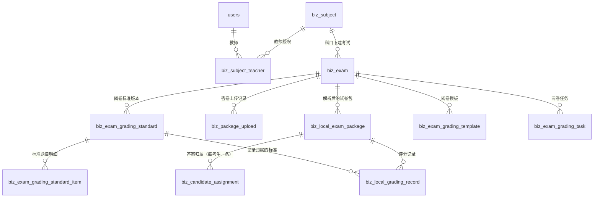

# 智能评分工作台 数据库设计文档

> 更新日期：2026-11-22
> 适用范围：智能评分工作台（教师评分业务）当前使用的全部数据表
> 数据库：MySQL；ORM：SQLAlchemy（模型定义见后端 `app/models/exam/biz_models.py` 与 `app/models/modules/`）
> 编排说明：本文按**系统使用流程**编排——科目 → 考试（空白试卷）→ 阅卷标准 → 阅卷模板 → 答卷上传 → 解析与试卷包 → 答案抽取 → 阅卷任务 → 评分记录 → 结果与导出。

## 一、表关系总览



业务主链路（即本文各章节顺序）：**科目 → 考试（空白试卷）→ 阅卷标准（快照）→ 阅卷模板 → 答卷上传（解析） → 答案抽取 → 阅卷任务 → 试阅/评阅（评分记录） → 查看结果/导出**。

通用约定：

- 所有表主键为自增 `int`；
- 时间字段默认取北京时间（`Asia/Shanghai`）；
- `users` / `mcp_services` 等为平台原系统表，业务表通过外键或普通 ID 引用。

---

## 二、科目管理

### 1. biz_subject 科目表

一行 = 一个科目（如“数字媒体”“人工智能”）。对应页面：科目管理。

| 字段 | 类型 | 空 | 说明 |
|---|---|---|---|
| subject_id | int | 否 | 主键 |
| subject_no | varchar(50) | 否 | 科目编号（如 06、10） |
| subject_name | varchar(100) | 否 | 科目名称 |
| creator_id | int | 否 | 创建教师（→ users.id） |
| created_at | datetime | 否 | 创建时间 |
| remark | varchar(255) | 是 | 备注 |

### 2. biz_subject_teacher 教师科目授权表

一行 = 一条“教师可访问某科目”的授权（科目管理页里给教师分配科目）。唯一索引 `(subject_id, teacher_id)`。

| 字段 | 类型 | 空 | 说明 |
|---|---|---|---|
| assignment_id | int | 否 | 主键 |
| subject_id | int | 否 | 科目（外键，级联删除） |
| teacher_id | int | 否 | 教师（→ users.id，级联删除） |
| created_at | datetime | 否 | 授权时间 |

---

## 三、考试管理

### 3. biz_exam 考试表

一行 = 一场考试。考试管理页创建考试并**上传空白试卷**（解析出 `blank_paper_json`，是后续阅卷标准与结构展示的基础）。

| 字段 | 类型 | 空 | 说明 |
|---|---|---|---|
| id | int | 否 | 主键（业务里的 exam_id） |
| subject_id | int | 否 | 所属科目 |
| exam_name | varchar(100) | 否 | 考试名称（如 11A、33A） |
| exam_time | datetime | 是 | 考试时间 |
| answer_key_path | varchar(255) | 是 | 答案卷文件路径（服务器磁盘） |
| blank_paper_path | varchar(255) | 是 | 空白试卷文件路径（服务器磁盘） |
| blank_paper_json | json | 是 | 空白试卷解析结构 `{大题:[{标题,题干,小题:[{题干,…}]}]}`——未建阅卷标准时的展示/导出结构来源 |
| assignment_strategy | varchar(50) | 否 | 答案归属策略（默认 `legacy_question_assignment`，决定抽取走哪套规则） |
| creator_id | int | 否 | 创建教师 |

---

## 四、新增阅卷标准

### 4. biz_exam_grading_standard 阅卷标准版本表

一行 = 一个**标准版本**（同一考试可多版本，version_no 递增）。阅卷任务绑定某一行；`paper_structure_json` 为全流程的试卷结构来源。

| 字段 | 类型 | 空 | 说明 |
|---|---|---|---|
| standard_id | int | 否 | 主键 |
| subject_id / exam_id / creator_id | int | 否 | 科目 / 考试 / 创建教师 |
| version_no | int | 否 | 标准版本号（V1、V2…） |
| standard_items | json | 否 | 题目条目**摘要**：`[{question_no, item_id, question_version_no, source_standard_version_no}]`——完整内容在条目表 |
| paper_structure_json | json | 是 | **结构快照**：创建时从空白卷复制，之后吸收加题/改题干冻结——阅卷/展示/导出的结构来源 |
| remark | varchar(255) | 是 | 备注 |
| created_at / updated_at | datetime | 否 | 创建 / 更新时间 |

### 5. biz_exam_grading_standard_item 阅卷标准题目明细表

一行 = 某标准版本里的一道题，**题目内容（题干/参考答案/评分标准/总分）的权威存储**。内容不变的题跨版本共用同一行（item_id 相同），内容变了才新增行并递增题目版本号。

| 字段 | 类型 | 空 | 说明 |
|---|---|---|---|
| item_id | int | 否 | 主键（= 导出 Excel 里的“我们自己的题目 id”） |
| standard_id / subject_id / exam_id / creator_id | int | 否 | 所属标准版本 / 科目 / 考试 / 教师 |
| question_no | varchar(50) | 否 | 题号（"1"、"2.1"…） |
| question_type | varchar(50) | 否 | 题型（short_answer/image/operation/code/file） |
| mcp_service_id / mcp_service_name | varchar | 否 | 绑定的 AI 评分服务 |
| question_text | text | 是 | **题干全文** |
| reference_answer / grading_criteria | text | 是 | 参考答案 / 评分标准 |
| question_version_no | int | 否 | 题目版本号（内容变化时递增） |
| source_standard_version_no | int | 是 | 该题内容源自哪个标准版本 |
| mcp_params | json | 是 | 评分服务扩展参数（setup_sql、adaptation_rules 等） |
| max_score | decimal(8,2) | 是 | 总分 |
| remark | varchar(255) | 是 | 备注 |
| created_at / updated_at | datetime | 否 | 创建 / 更新时间 |

---

## 五、阅卷模板（可选）

### 6. biz_exam_grading_template 阅卷模板表

一行 = 一个阅卷模板。两个来源：①教师在“阅卷模板管理”页从标准组装；②创建阅卷任务时系统按绑定标准自动生成 `__system_standard_{标准id}`（不向教师展示）。同一任务包+标准只会复用一份系统模板。

| 字段 | 类型 | 空 | 说明 |
|---|---|---|---|
| template_id | int | 否 | 主键 |
| subject_id / exam_id / creator_id | int | 否 | 科目 / 考试 / 创建教师 |
| template_name | varchar(100) | 否 | 模板名（系统模板名为 `__system_standard_{标准id}`） |
| template_items | json | 否 | 明细：`[{question_no, standard_id, standard_version_no, question_version_no, standard_item}]`——每题绑定哪个标准条目 |
| description | text | 是 | 描述 |
| created_at / updated_at | datetime | 否 | 创建 / 更新时间 |

---

## 六、答卷上传

### 7. biz_package_upload 答卷上传记录表

一行 = 一次“答卷上传”动作（上传后自动触发解析与答案抽取）。

| 字段 | 类型 | 空 | 说明 |
|---|---|---|---|
| upload_id | int | 否 | 主键 |
| subject_id / exam_id | int | 否 | 所属科目 / 考试 |
| creator_id | int | 否 | 上传教师 |
| package_name | varchar(120) | 否 | 试卷包名称 |
| storage_path | varchar(500) | 否 | 上传压缩包在磁盘的路径 |
| status | varchar(20) | 否 | 上传记录状态：`uploaded` → `parsing` → `parsed` / `failed` |
| parse_error | text | 是 | 解析失败原因 |
| local_package_id | int | 是 | 解析成功后生成的本地试卷包 ID（→ biz_local_exam_package） |
| assignment_status | varchar(20) | 否 | 答案抽取状态：`pending` / `extracting` / `extracted` / `failed` |
| assignment_error | text | 是 | 抽取失败原因 |
| created_at / updated_at | datetime | 否 | 创建 / 更新时间 |

---

## 七、解析与试卷包

### 8. biz_local_exam_package 本地试卷包登记表（核心表）

一行 = 一个解析完成的试卷包，整包解析产物都在本行的大 JSON 列里。前端路由中的 `local_45` 即 `local_package_id`。

| 字段 | 类型 | 空 | 说明 |
|---|---|---|---|
| local_package_id | int | 否 | 主键 |
| subject_id / exam_id / creator_id | int | 否 | 科目 / 考试 / 创建教师 |
| package_name | varchar(100) | 否 | 展示名（解析时间 + 原包名） |
| package_fingerprint | varchar(128) | 否 | 包指纹（sha256），用于识别同一包重复上传 |
| quick_fingerprint / file_fingerprint / student_no_hash | varchar(128) | 是 | 快速指纹 / 文件指纹 / 考生名单哈希（历史包探测复用） |
| folder_name / json_file_name / json_file_size | varchar/int | 是 | 原始目录名 / 考生 JSON 文件名 / 大小 |
| student_count | int | 否 | 考生数量 |
| image_count | int | 否 | 图片数量 |
| word_document_count | int | 否 | Word 答卷文档数量 |
| total_file_size / total_image_size / total_word_size | int | 是 | 各类总大小 |
| structure_summary | json | 是 | 解析摘要（目录名、命中的答案卷/空白卷文件名） |
| answer_index / file_manifest | json | 是 | 答案索引 / 文件清单 |
| parsed_students | json | 是 | **全部考生的答卷解析结构**：每人 `result[]`（大题→sub_question，含作答文本 `answer`、文件摘要 `answer_files`）——评阅页题树、作答文本的来源 |
| parsed_image_manifest | json | 是 | 全包图片清单（name/relative_path/storage_path） |
| reference_answers / answer_key_json | json | 是 | 参考答案 / 答案卷解析结果 |
| blank_paper_json | json | 是 | 包结构：有阅卷标准时=该标准的**结构快照**，否则=空白卷解析结构 |
| parsed_storage_path | varchar(500) | 是 | 解析产物磁盘目录（`parsed/<学号>_KS/…` 与答卷文档在此） |
| status | varchar(20) | 否 | `active` 等 |
| created_at / updated_at | datetime | 否 | 创建 / 更新时间 |

解析产物的磁盘目录（与上表 JSON 对应）：

```
data/teacher_scoring/local-packages/<教师ID>/<包ID>/
├── input\                  上传的原始答卷（考生目录、KS 文件夹）
├── supporting\             包内答案卷 / 空白卷原件
└── parsed\
    ├── students.json               全部考生解析结构
    ├── blank-paper.json            试卷结构（有标准时=标准快照）
    ├── parse-report.json           答卷解析报告
    ├── manifest.json / unified-paper.json / candidate-answers.json
    └── candidate-assignment\candidate-assignments.json   答案抽取结果
```

---

## 八、答案抽取

### 9. biz_candidate_assignment 答案抽取归属表

一行 = 一个考生，`assignment_json` 为该考生的完整归属档案（前端“答案抽取报告”、评阅页答案展示、导出的“考生答案”列均取自此表）。唯一索引 `(local_package_id, student_no)`。

| 字段 | 类型 | 空 | 说明 |
|---|---|---|---|
| assignment_id | int | 否 | 主键 |
| local_package_id | int | 否 | 所属试卷包（外键，级联删除） |
| subject_id / exam_id | int | 否 | 科目 / 考试 |
| creator_id | int | 否 | 创建教师 |
| student_no | varchar(50) | 否 | 考生考号 |
| paper_code | varchar(20) | 否 | 试卷代码前缀（11A/33A…），决定抽取规则：11 系走文本抽取、其余走文件归属 |
| assignment_source | varchar(50) | 否 | 归属策略来源（`legacy_question_assignment` 等） |
| assignment_json | json | 否 | **完整归属档案**，结构见下 |
| status | varchar(20) | 否 | 抽取状态（success/failed） |
| error_message | text | 是 | 失败原因 |
| created_at / updated_at | datetime | 否 | 创建 / 更新时间 |

`assignment_json` 结构（真实示例）：

```
{
  status / source / paperCode / generatedAt / schemaVersion / warnings
  student: {
    studentId, status, isBlank, sourceFolder,
    fileCount / abnormalFileCount / files[]      ← 全部文件明细
    unassignedFiles[]                            ← 未归属到题目的文件
    questions[]: [                               ← 每题的文件归属（文本卷 files 被清空）
      { questionCode: "2", questionLabel: "2", fileCount, files: [...] }
    ]
    questionDocuments: { "1": 文档名, "2": 文档名 }   ← 题号→答卷文档映射
    questionContents[]: [                        ← 按题挂靠的抽取内容（导出“考生答案”来源）
      { questionNo: "1", fields: { 大模型名称: "豆包", … }, answerText: "作答原文" }
    ]
    extractedContent: {                          ← 主文档字段级抽取 + 每文档分组
      fields: {…}, sourceFile: "…/WordA.docx", documents: [ { sourceFile, sourceType, fields } ]
    }
  }
  summary {…}
}
```

---

## 九、创建阅卷任务

### 10. biz_exam_grading_task 阅卷任务表

一行 = 一个阅卷任务（试卷包 × 阅卷标准的绑定）。唯一索引 `(creator_id, local_package_id, standard_id)`：同一包 + 同一标准只允许一个任务（切换标准时查重依据）。

| 字段 | 类型 | 空 | 说明 |
|---|---|---|---|
| task_id | int | 否 | 主键 |
| subject_id / exam_id | int | 否 | 科目 / 考试 |
| local_package_id | int | 否 | 评阅的试卷包 |
| standard_id | int | 否 | **绑定的阅卷标准**（“切换阅卷标准”改的就是它） |
| template_id | int | 否 | 内部兼容的系统模板 ID |
| creator_id / created_at | int/datetime | 否 | 创建教师 / 时间 |

---

## 十、试阅与评阅

### 11. biz_local_grading_record 评分记录表（核心表）

一行 = 一次评分动作的结果（每完成一题落一条）。**自包含历史快照**：题干、作答、信封都定格在记录里；切换标准后旧记录保留原 standard_id，结果页按“每题取最新记录”聚合展示。

| 字段 | 类型 | 空 | 说明 |
|---|---|---|---|
| record_id | int | 否 | 主键 |
| local_package_id / subject_id / exam_id / creator_id | int | 否 | 试卷包 / 科目 / 考试 / 评分教师 |
| package_fingerprint | varchar(128) | 否 | 包指纹 |
| student_no | varchar(50) | 否 | 考生考号 |
| question_no | varchar(50) | 否 | 题号（"1"、"1.1"、"2"…） |
| question_label | varchar(100) | 是 | 题目标签 |
| grading_mode | varchar(30) | 是 | 评阅方式（batch-trial / formal-grade / manual_review…） |
| mcp_service_id / mcp_service_name | varchar | 是 | 评分服务 |
| template_id / template_name | int/varchar | 是 | 内部兼容的模板信息 |
| standard_label | varchar(255) | 是 | “阅卷标准 V3 / 本题 V2”展示标签 |
| standard_id | int | 是 | **评分所绑定的标准版本**（结果页按“每题取最新”聚合，不按标准过滤） |
| standard_version_no / question_version_no | int | 是 | 标准 / 题目版本号 |
| score / max_score | decimal(8,2) | 是 | 得分 / 满分 |
| grading_desc | text | 是 | **评语**（服务返回评语 + 复核提示“（复核提示：…）”附加） |
| question_text / answer_text | text | 是 | 评分时的题干 / 作答文本（历史快照冗余） |
| image_name | varchar(255) | 是 | 作答截图文件名 |
| mcp_raw_json | json | 是 | 评分服务**原始信封**（score/comment/needs_review/review_summary/evidence_refs…） |
| needs_manual | int | 否 | 需人工复核：服务 needs_review 非空或无分数 → 1；人工复核录入 → 0 |
| is_trial | bool | 否 | 试阅记录 / 正式评阅记录 |
| round_note / round_starred | — | 是 | 评阅轮次备注 / 星标 |
| graded_at / updated_at | datetime | 否 | 评阅时间 / 更新时间 |

---

## 十一、旧文件上传流程的表（当前主流程不写入）

早期“整包文件上传评阅”流程使用，当前 33A/11A 主流程（答卷上传 → 归属抽取 → 线程池评阅）不写这三张表，仅保留兼容。

| 表 | 用途 |
|---|---|
| biz_exam_package | 旧整包文件上传登记（package_id/exam_id/package_name/file_path/extract_path/uploaded_at） |
| biz_answer_sheet | 旧流程学生答卷登记（student_no/exam_id/package_id/question_id/upload_type/file_path/text_content/page_mapping） |
| biz_answer_file | 旧流程答卷文件明细（answer_id/file_name/file_path/file_type/relative_path/file_size） |

---

## 十二、平台基础表（沿用原系统）

| 表 | 用途 |
|---|---|
| users | 用户账号（username/password 哈希/fullname/phone/email/avatar/is_admin/status） |
| tenants / user_tenants | 租户与用户-租户关系 |
| mcp_services | MCP 评分服务注册（service_uuid/name/sse_url/protocol_type/enabled/auth_* /config_params/service_type/is_public…）——阅卷标准绑定的评分服务即来自此表 |
| mcp_tools / mcp_modules | MCP 工具与模块注册 |
| mcp_access_logs / mcp_secret_statistics / mcp_secret_* | 访问日志与密钥统计（平台运维用） |

---

## 十三、导出与展示的数据来源速查

| 功能 | 数据来源 |
|---|---|
| 查看评阅结果页（导出 Excel：id/考号、question_no/题号、standard_version_no/标准版本、score/得分、max_score/满分、grading_desc/评语、image_name/作答截图、needs_manual/需人工复核、graded_at/评阅时间） | 评分记录表（每题取最新一条） |
| 阅卷完成报告“评阅汇总结果”列（标红） | 评分记录 needs_manual=1 且复核内容（信封 review_summary / 评语“（复核提示：…）”）非空 |
| 答案抽取报告 | 归属表 assignment_json（questions 文件归属 + questionContents 按题内容 + extractedContent 字段） |
| 试卷结构页 / 评阅页题树 | 标准结构快照（缺失回退空白卷结构） |
| 任务进度条 | 评分记录覆盖情况（不按标准过滤，重评覆盖） |
| 导出 JSON（id/total_score/result[]） | 评分记录（每题取最新）+ 标准条目（qid）+ 结构快照（题干原文）+ 归属表（考生答案） |
